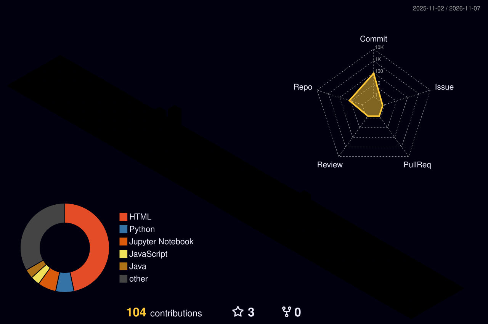

# Hey there, I'm Sasmitha Nimesh 👋
### BSc (Hons) Computer Science With AI Undergraduate · Builder · Community Leader

  

  
  
  
  
  

## 👨‍💻 Who Am I

I'm a **Computer Science with Artificial Intelligence** undergraduate at the **National Institute of Business Management (NIBM, Sri Lanka)** (in collaboration with **Coventry University**), passionate about building useful technology that bridges intelligent software, hardware, and real-world impact.

- 🧠 Exploring **Artificial Intelligence, Machine Learning, and Computer Vision**
- 🌐 Building scalable applications through **Full-Stack Web Development**
- 🤖 Experimenting with **Robotics, Embedded Systems (ESP32/Arduino), and IoT**
- 🎨 Combining analytical thinking in **Mathematics & Data Analysis** with creative design and digital publishing
- 🌱 Driven by hands-on iteration: **Curiosity → Experimentation → Building → Learning → Repeat**

## 🏆 Experience, Leadership & Volunteering

- 💼 **Virtual Intern** — *SaiKet Systems*  
  Completed an intensive 30-day virtual internship developing and testing practical software engineering deliverables.
- 🤖 **Organizing Committee Member** — *IEEE Student Branch of NIBM & NIBMCodeX*  
  Spearheading technical events, AI workshops, and STEM awareness initiatives including the **KIC Robo-Invent** project.
- 🤝 **District Coordinator (Polonnaruwa District)** — *Sasnaka Sansada Foundation*  
  Leading district-level volunteer engagement, organizing *Ganitha Saviya* mathematics seminars, and driving community relief and environmental initiatives (*Regreen Earth Project*).

## 📈 GitHub Dashboard

  

    
    
  

  

    
  

  

    
  

## 🏙️ 3D Contribution City

  <picture>
    <source media="(prefers-color-scheme: dark)" srcset="https://raw.githubusercontent.com/SasmithaNimesh/SasmithaNimesh/output/profile-night-rainbow.svg" />
    <source media="(prefers-color-scheme: light)" srcset="https://raw.githubusercontent.com/SasmithaNimesh/SasmithaNimesh/output/profile-green-animate.svg" />
    
  </picture>

## 🐍 Contribution Trail

  <picture>
    <source media="(prefers-color-scheme: dark)" srcset="https://raw.githubusercontent.com/SasmithaNimesh/SasmithaNimesh/output/github-contribution-grid-snake-dark.svg" />
    <source media="(prefers-color-scheme: light)" srcset="https://raw.githubusercontent.com/SasmithaNimesh/SasmithaNimesh/output/github-contribution-grid-snake.svg" />
    
  </picture>

## 🛰️ Featured Projects

<table>
  <tr>
    <td width="50%" valign="top">
      <h3>🌍 ConnectLanka — Tourism Platform</h3>
      An AI-assisted tourism web application designed to help travelers plan trips across Sri Lanka with smart destination, hotel, and transport recommendations.
        
      
      
      
        
      
    </td>
    <td width="50%" valign="top">
      <h3>📰 AI News Aggregator</h3>
      A full-stack intelligent news platform integrated with Google Gemini to automatically generate concise summaries of global headlines.
        
      
      
      
      
        
      
    </td>
  </tr>
  <tr>
    <td width="50%" valign="top">
      <h3>🛒 Smart Shop Buddy — IoT Cart</h3>
      An ESP32-based smart shopping cart using RFID scanning, load-cell weight verification, and real-time Firebase sync for automated billing.
        
      
      
      
      
        
      
    </td>
    <td width="50%" valign="top">
      <h3>🧠 Interactive Personal Portfolio</h3>
      A responsive developer portfolio built with vanilla HTML, CSS, and JavaScript, featuring an interactive HTML5 Canvas neural-network particle simulation.
        
      
      
      
      
        
      
    </td>
  </tr>
  <tr>
    <td width="50%" valign="top">
      <h3>🌱 AgroVision — Farm Management</h3>
      A modular Java application applying object-oriented programming principles to monitor farm resources, water usage, and crop cycles.
        
      
      
        
      
    </td>
    <td width="50%" valign="top">
      <h3>📊 Student Performance EDA</h3>
      An exploratory data-analysis project in R investigating the correlation between student engagement, resource utilization, and academic outcomes.
        
      
      
        
      
    </td>
  </tr>
</table>

  

## 🧰 Tech Stack & Tools

| **Languages & Data Science** | **Full-Stack Web** | **IoT, Cloud & Dev Tools** |
| :---: | :---: | :---: |
|  |  |  |

<h3 align="center">🚀 Core Focus Areas</h3>

  
  
  
  
  

## 🤝 Let's Connect

I'm always open to collaborating on AI projects, full-stack web apps, robotics initiatives, and tech community events.

  
  
  

**Thanks for stopping by!**  
Build with curiosity. Learn by doing. Keep improving. ✨

